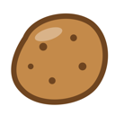
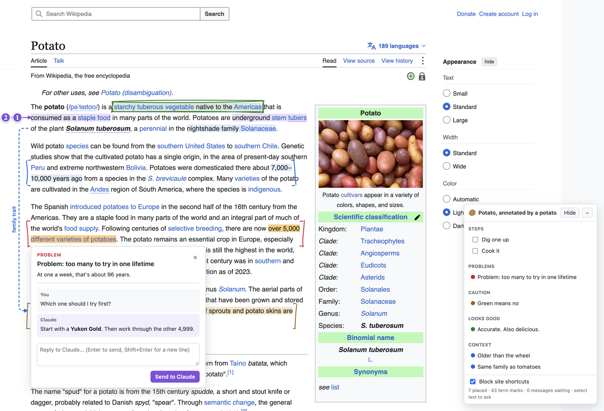

# Anno Tater



Meet Anno 🥔. He's a 'tater. And he's here to help you read the web with Claude.

Ask Claude to review a design doc, untangle a dense article, or walk you through a manual test, and Anno spreads Claude's notes right across the page: problems in red, steps to follow, definitions on hover. Got a question? Ask it on the page. Claude answers there too. He's no couch potato.



## Install

```sh
curl -fsSL https://raw.githubusercontent.com/Farmer-Pete/anno-tater/main/install.sh | sh
```

Or from a clone:

```sh
git clone git@github.com:Farmer-Pete/anno-tater.git
cd anno-tater
./install.sh
```

Works with Chrome, Zen, and Firefox Developer Edition, and needs Node 20 or newer.
