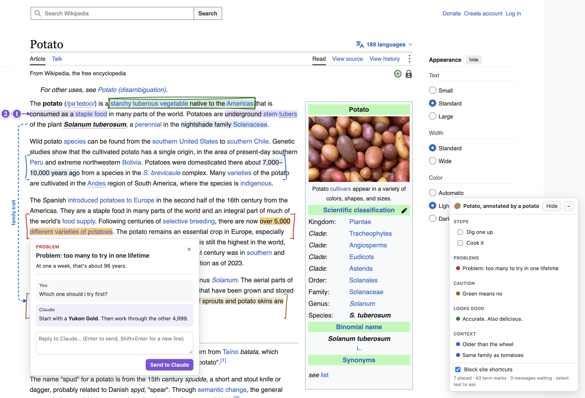

# Anno Tater


Meet Anno 🥔. He's a 'tater. And he's here to help you read the web with Claude.

Ask Claude to review a design doc, untangle a dense article, or walk you through a manual test, and Anno spreads Claude's notes right across the page: problems in red, steps to follow, definitions on hover. Got a question? Ask it on the page. Claude answers there too. He's no couch potato.



## Install

```sh
curl -fsSL https://github.com/Farmer-Pete/anno-tater/releases/latest/download/install.sh | sh
```

That installs the release the script came with. The one-liner trusts the script it downloads. It checks every file against the release's `SHA256SUMS` before unpacking anything. With the GitHub CLI logged in, it also checks that this repo's Release workflow built them. To check the installer itself first:

```sh
curl -fsSLO https://github.com/Farmer-Pete/anno-tater/releases/latest/download/install.sh
gh attestation verify install.sh --repo Farmer-Pete/anno-tater
sh install.sh
```

Or from a clone:

```sh
git clone git@github.com:Farmer-Pete/anno-tater.git
cd anno-tater
./install.sh
```

Works with Chrome, Zen, and Firefox Developer Edition, and needs Node 20 or newer.

Anno Tater isn't in the Chrome Web Store or signed by Mozilla, so installing it gives up a browser protection. Chrome loads it unpacked in Developer mode from the folder the installer names (`~/.local/share/anno-tater/chrome` unless `ANNO_TATER_HOME` or `XDG_DATA_HOME` moves it), and anything running as you can change that folder: the changed code runs on every site you allowed, the next time the extension reloads. The installer makes the folder readable and writable by you alone, and on macOS removes any access-control entries that would let others in. Zen and Firefox Developer Edition install it with `xpinstall.signatures.required` set to false, which lets that browser profile install any unsigned add-on. Use a profile you keep for work you'd trust Anno Tater with, and don't install it where those trade-offs aren't yours to make, such as a managed work browser.
