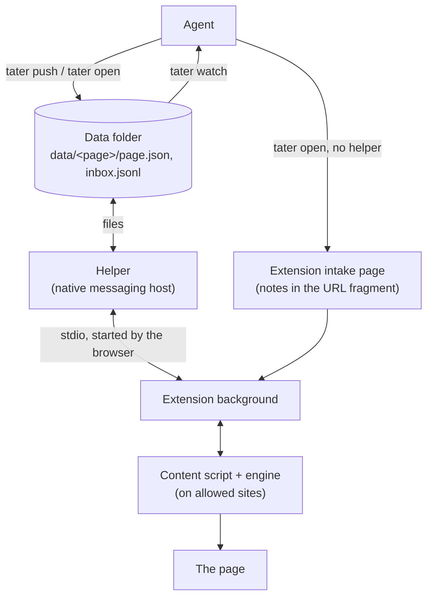

# Anno Tater design

Anno Tater lets a coding agent such as Claude Code mark up any web page for a person. The agent writes one small JSON file per page. The browser extension draws it: highlights that explain a problem, numbered steps, glossary hovers, boxes and arrows. The person can reply from the page, and the reply reaches the agent that wrote the notes.

## Goals

- **Cheap for the agent.** The agent writes a notes file once. The extension does the anchoring and drawing. A reply from the page reaches the agent as one short line, never as the page.
- **Marks that stay.** Highlights survive reloads and pages that re-render their own DOM.
- **Least privilege.** The extension runs only on sites the person allowed, one click per site.
- **Chrome, Zen, and Firefox Developer Edition** from one code base. Firefox-based browsers run it unsigned (`xpinstall.signatures.required = false`); regular Firefox ignores that setting and isn't supported.
- **Works without installing anything else.** Without the helper, notes still reach the page. Replies need the helper.

## Pieces



- **`tater` CLI** (`src/cli`). Validates and stores notes files, opens pages in the default browser, prints new replies for the agent, and installs the helper. The build bundles it, with the helper, into `skill/bin` for the Claude Code skill.
- **Helper** (`src/host`). A native messaging host. The browser starts it on demand over stdio, so it needs no open port and nothing else can reach it. It reads notes files, tells the extension when one changes, and appends the person's messages to an inbox file.
- **Background** (`src/extension/background.ts`). Holds the notes cache, talks to the helper, registers the content script for allowed sites, and drives the toolbar badge.
- **Content script and engine** (`src/extension/content.ts`, `src/engine`). Anchors notes to text and draws them.
- **Shared** (`src/shared`). The notes schema, URL matching, and the native messaging framing.

## Two modes

| | No helper | With helper |
| --- | --- | --- |
| Install | The extension only | Plus the helper, registered by `install.sh` (or `tater install`) |
| Agent to page | `tater open` carries the notes to the extension's intake page in the URL fragment | `tater push` writes a file; open pages update live |
| Page to agent | None. Cards hide the reply box | Replies, questions on a selection, and "Mark done" land in the agent's inbox |

### Why the intake page, not the target URL

`tater open` could put the notes in the target page's own fragment. The fragment never reaches the site's server, but the site's scripts could read it on a domain the extension can't run on yet, and seeing that URL at all needs the "tabs" permission ("Read your browsing history"). Instead `tater open` opens the extension's own `open.html` with the notes in its fragment. That page stores them, asks for site access if needed (the click there counts as the required user gesture), and then sends the browser on to the target page.

Chrome: the manifest's `key` fixes the extension ID, so the intake URL is known in advance. Zen and Firefox Developer Edition give each install a random internal host name; `tater` reads it from the profile's `prefs.js` (`extensions.webextensions.uuids`).

## Notes file

```json
{
  "title": "Design review",
  "scope": "article.markdown-body",
  "notes": [
    { "id": "n1", "kind": "issue", "quote": "exact text on the page", "prefix": "optional", "suffix": "optional",
      "title": "Short title", "body": "Markdown subset", "decorate": "box", "thread": [] }
  ],
  "links": [{ "from": "n1", "to": "n2", "label": "same root cause" },
            { "from": "n1", "to": { "url": "https://github.com/org/repo/pull/7/changes", "note": "f2" } }],
  "glossary": [{ "term": "NCA", "def": "network-config-analysis" }],
  "acked": []
}
```

- `url` is the page. Its address without the scheme or `#fragment` is the page key. A fragment route (`#/settings`, `#!/settings`) stays in the key.
- `kind` is one of `issue`, `caution`, `agree`, `info`, `step`. Steps also have `step: <number>`.
- `decorate` is one of `box`, `circle`, `underline`, `bracket`.
- After each draw the page saves a placement report in its state (placed count, unplaced and ambiguous notes, and a hash of the anchors it drew from), which `tater status --page` prints for the agent.
- Anchoring follows the W3C TextQuoteSelector: an exact quote with optional prefix and suffix. A quote that isn't found goes in the panel's "Couldn't place" list. Nothing is placed by a guess. A note without a quote is about the whole page and sits at the top of the panel.

## Rendering

- Text highlights use the CSS Custom Highlight API. It paints ranges without changing the DOM, so a page re-rendering its own nodes can't erase them. A MutationObserver re-anchors when the nodes under a range are replaced.
- Cards, the panel, pins, and SVG arrows live in one Shadow DOM host, so page CSS and our CSS don't touch.
- Keys typed in our UI never reach the page. From the page's side they look like they come from a plain element, so its shortcuts would fire. A "Block site shortcuts" toggle (on by default) also blocks the page's shortcuts outside its own text fields.

## Pages are the key

A page's address, without the scheme or the `#fragment`, keys everything:

| File | What | Shared by |
| --- | --- | --- |
| `data/<page>/page.json` | The notes | every browser |
| `data/<page>/state.json` | Ticked steps and read replies | every browser (two-way mode) |
| `data/<page>/inbox.jsonl` | The person's messages | every browser |

A fragment route (`#/settings`, `#!/settings`) stays in the key, since single-page apps route with it; a bare `#/` is the root. A single-page app also changes its address without a reload, so the content script checks the address on `hashchange`, on `popstate`, and twice a second, and asks for the new page's notes when the key changes.

So a page looks the same in Chrome, Zen, and Firefox Developer Edition, and a step ticked in one shows as ticked in the others. Each browser starts its own helper; all of them share the data folder and watch it, so a change made through one browser reaches the others. Hidden or shown and "Block site shortcuts" stay per browser, as view settings. Without the helper, a browser keeps its own copy of the page state.

The trade-off is deliberate: a page has one notes file, so two agent sessions on the same page share its replies and would replace each other's notes. `tater push` records the session that wrote the notes (Claude Code's `CLAUDE_CODE_SESSION_ID`) and refuses to replace another session's notes without `--force`. Sessions on different pages never cross. "Ask Claude about this page" on a page without notes lands in that page's inbox; `tater watch --all` shows it, and the answer starts the page's notes file.

## Native messaging

Each message is a 4-byte little-endian length followed by UTF-8 JSON. The browser caps a message to the extension at 1 MB. `tater install` writes the host manifest to:

- Chrome: `~/Library/Application Support/Google/Chrome/NativeMessagingHosts/`
- Zen and Firefox Developer Edition: `~/Library/Application Support/Mozilla/NativeMessagingHosts/` (Zen reads Mozilla's folder, zen-browser/desktop#13214)

It also writes a launcher script with the absolute path to `node`, because apps started from the Dock don't get the shell's PATH.
